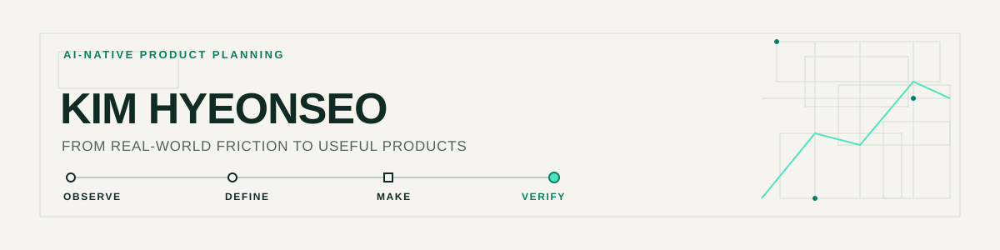

# 불편을 발견하고, 쓸 수 있는 것으로 만듭니다.

도시계획 실무에서 출발해 AI로 업무를 개선하고 서비스를 기획·제작하는 김현서입니다.  
문제를 정의하고, 프로토타입으로 구체화하고, 근거와 피드백으로 다듬습니다.

## 실무에서 바꾼 것

### 3시간 → 5분

공공데이터를 도면과 시설별 자료로 정리하는 반복 업무를 AI로 자동화했습니다. **제 업무의 자료 정리 1회 기준으로 약 3시간을 약 5분으로 줄였고**, 확보한 시간은 시설 개수·면적·위치를 원본과 대조하고 보완하는 데 사용했습니다.

### 외주에서 직접 제작으로

기존 3D 모델을 바탕으로 재질·조명·주변 맥락을 AI로 시각화해 설계 설명 이미지를 직접 제작했습니다. 원본 모델과 대조하며 수정 사항을 바로 반영했고, 외주 대기와 비용을 줄였습니다.

## 만든 것

### 팔템

도매 셀러가 다음에 팔 상품을 고르고 준비할 수 있도록 시즌 일정, 도매처 조건, 예상 마진을 한 흐름에 모았습니다. 기획과 판매자 화면 제작, 배포를 맡아 개발자와 함께 개선하고 있습니다.

[서비스 둘러보기 ↗](https://8tem.kr/welcome)

### 호밍

낯선 곳에서도 집까지 막차가 얼마나 남았는지 바로 보고 출발을 판단하는 앱입니다. 기획부터 앱 제작까지 맡았으며, 시간이 애매할 때는 더 이른 시각을 안내하는 보수적인 계산 원칙을 세웠습니다.

### 알려봄

소상공인과 1인 사업자가 무엇을 언제 어디에 홍보할지 정하도록 돕는 코칭 서비스입니다. 기능 명세와 프로토타입을 v1부터 v3까지 함께 개선했고, 추천을 보여 줄 때 확인된 근거와 추정을 구분했습니다.

## 일하는 방식

- 문제와 첫 버전의 범위를 먼저 문서로 정합니다.
- AI로 만든 프로토타입을 일찍 공유하고 화면·기능 단위로 피드백을 반영합니다.
- AI의 제안과 확인된 사실을 구분하고 결과를 원본과 대조합니다.

